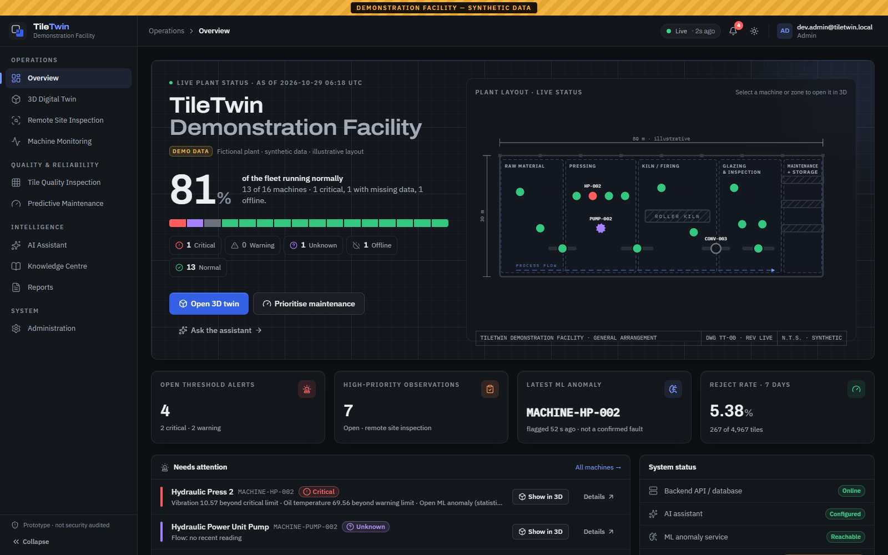
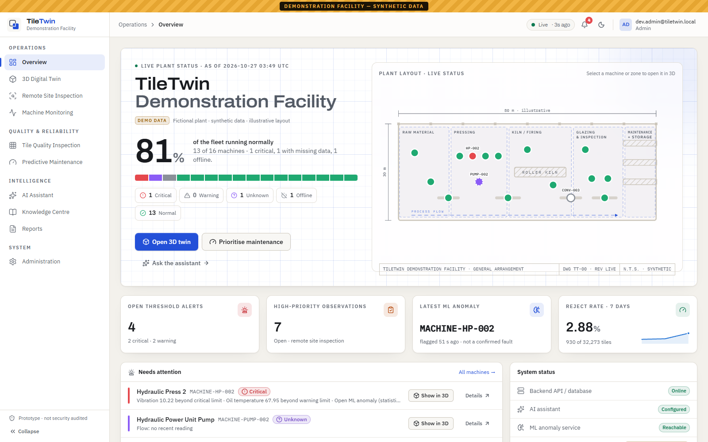
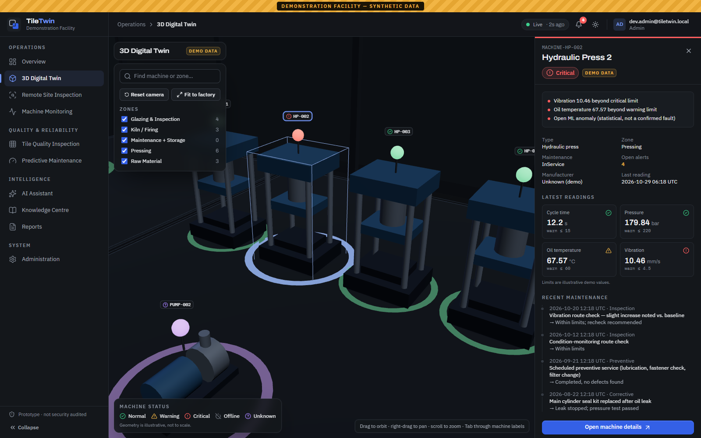
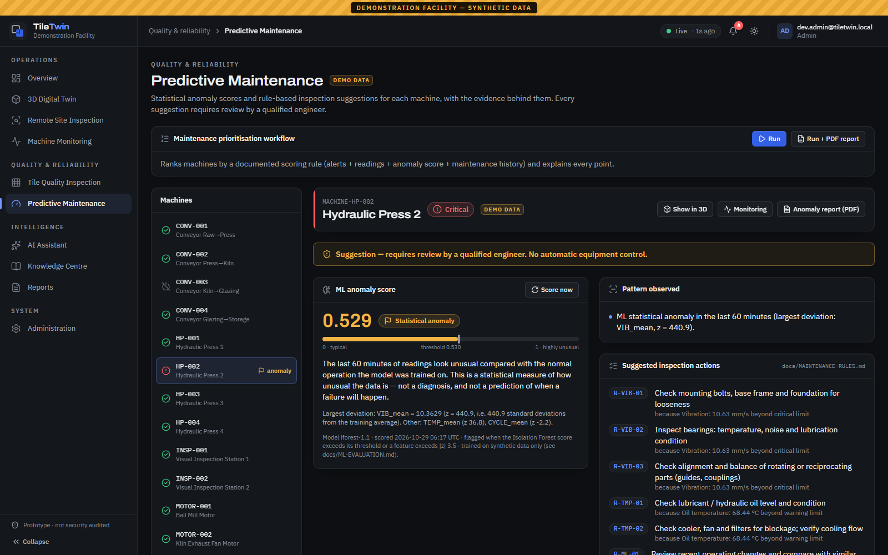
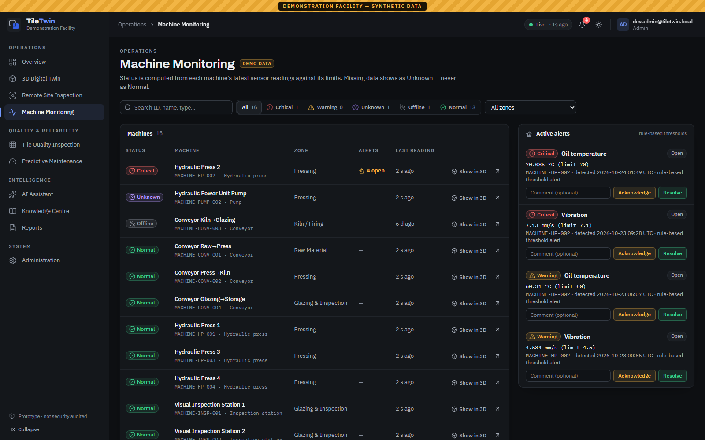

# TileTwin AI

Concept demo of an industrial digital twin, remote site inspection, machine monitoring, predictive
maintenance, tile quality inspection and an AI assistant for the **TileTwin Demonstration Facility** —
a **fictional** tile plant. **All data is synthetic.** It does not represent any real company or site.

> **Prototype — no security audit. Do not deploy as-is.**
> PDF reports use QuestPDF: its Community licence is free only for organisations under the revenue
> threshold — a company adopting this must check QuestPDF licensing.

## Screenshots

All screenshots show the fictional plant with synthetic data.

| Overview (dark theme) | Overview (light theme) |
|---|---|
|  |  |
| **3D digital twin** — machine selected, live readings from the API | **Predictive maintenance** — ML anomaly score with explanation |
|  |  |



## Prerequisites

| Tool | Version used |
|---|---|
| Docker Desktop (with `docker compose`) | 4.96 |
| .NET SDK | 10.0 |
| Node.js / npm | 22.x / 11.x |
| Python | 3.11+ |

## Ports

| Service | URL |
|---|---|
| PostgreSQL 16 + pgvector (Docker) | `localhost:5434` |
| Backend API | http://localhost:5080 — health `/api/health`, Swagger UI `/swagger` |
| ML service | http://localhost:8001 — health `/health` |
| Frontend | **http://localhost:5180** (proxies `/api` and `/assets3d` to the backend) |

## First-time setup (PowerShell, from the repo root)

```powershell
# 1. Configuration
copy .env.example .env
```

Edit `.env` and set at least:

| Variable | Value |
|---|---|
| `POSTGRES_PASSWORD` | any password; use the **same** value after `Password=` in `POSTGRES_CONNECTION` |
| `JWT__SigningKey` | a long random value (≥ 32 chars), e.g. the output of `openssl rand -base64 48` (available in Git Bash) |
| `DEV_SEED_USER_PASSWORD` | a password (≥ 12 chars) for the DEV ONLY users, needed to sign in |
| `GROQ_API_KEY` + `LLM__Provider=groq` | optional AI assistant via Groq (default model `openai/gpt-oss-120b`) |
| `ANTHROPIC_API_KEY`, `LLM__Model` | optional alternative: Claude (e.g. `claude-opus-5-5`). No AI key = **AI NOT CONFIGURED** |
| `TILE_MODEL_PATH` | optional ONNX tile model; empty = **MODEL NOT CONFIGURED** |

```powershell
# 2. Database
docker compose -f database/docker-compose.yml --env-file .env up -d

# 3. Backend (migrations and the demo seed run automatically on first API start)
dotnet tool restore
dotnet restore backend/TileTwin.slnx
# optional, apply migrations by hand:
dotnet ef database update --project backend/TileTwin.Infrastructure --startup-project backend/TileTwin.Api

# 4. ML service
cd ml-service
python -m venv .venv
.venv\Scripts\python -m pip install -r requirements.txt
cd ..

# 5. Frontend
cd frontend
npm install
cd ..
```

## Run (three terminals)

```powershell
dotnet run --project backend/TileTwin.Api --launch-profile http            # first start ~20 s (seeding)
cd ml-service; .venv\Scripts\python -m uvicorn app.main:app --port 8001     # trains demo models on first start
cd frontend; npm run dev
```

Open http://localhost:5180. Then run the scenarios in [docs/DEMO-SCRIPT.md](docs/DEMO-SCRIPT.md), or
check everything automatically:

```powershell
python scripts/smoke.py      # 20 end-to-end checks covering Scenarios A–D
```

## Users and access

- Read endpoints are open (demo viewer). Every write endpoint requires a JWT with a suitable role
  (`Viewer`, `Inspector`, `MaintenanceEngineer`, `Admin`) — sign in with the **Sign in** button in the top bar.
- There is **no default admin password**. DEV ONLY users exist only when the environment is
  `Development` **and** `DEV_SEED_USER_PASSWORD` is set: `dev.viewer@tiletwin.local`,
  `dev.inspector@tiletwin.local`, `dev.maintenanceengineer@tiletwin.local`, `dev.admin@tiletwin.local`.
  Admins create further users in **Administration**.

## Demo data

A deterministic synthetic dataset (fixed random seed): 1 site, 5 zones, 16 machines, 49 sensors,
7 days of 1-minute readings (~494k rows), 25 inspection observations with corrective actions,
maintenance records, production batches and two demo procedures. Every row is
`DataOrigin = Synthetic`, `SeedBatchId = demo-v1`. Scripted patterns: MACHINE-HP-002 drifts to
Critical, MACHINE-PUMP-002 loses its flow sensor (Unknown), MACHINE-CONV-003 is offline.

While the API runs, a simulator writes a reading per sensor every 5 s; after a restart or PC sleep it
fills missing minutes. **Administration → Reset demo data** (Admin) deletes only the synthetic demo rows
in one transaction and re-seeds; user-created rows are kept.

## Optional components

- **AI assistant**: set `GROQ_API_KEY` with `LLM__Provider=groq` (Groq, default model
  `openai/gpt-oss-120b`) or `ANTHROPIC_API_KEY` + `LLM__Model` (Claude), restart the API. Server-side
  only, read-only tools (plus report drafts), ≤ 6 tool calls per question, every call audited,
  rate-limited. The same provider rewords the maintenance-prioritisation recommendation.
- **ML service**: models train on synthetic data at first start. `python -m app.train` retrains,
  `python -m app.evaluate` regenerates [docs/ML-EVALUATION.md](docs/ML-EVALUATION.md). If the service is
  down the UI says "ML service unavailable" and shows no score.
- **Tile model**: see [docs/TILE-MODEL.md](docs/TILE-MODEL.md).
- **Semantic document search**: needs an `IEmbeddingProvider` implementation; otherwise keyword search.

## Tests

The backend integration tests use a real PostgreSQL database `tiletwin_test` (created automatically in
the compose Postgres), so start the database first. Stop the running API before `dotnet test` (it locks
the build output).

```powershell
dotnet test backend/TileTwin.slnx
cd frontend; npm test
cd ml-service; .venv\Scripts\python -m pytest
```

## Documentation

| Document | Content |
|---|---|
| [docs/PROGRESS.md](docs/PROGRESS.md) | Milestone log, test results, decisions, known limitations |
| [docs/ARCHITECTURE.md](docs/ARCHITECTURE.md) | Components, data flow, key decisions, security |
| [docs/DEMO-SCRIPT.md](docs/DEMO-SCRIPT.md) | Scenarios A–D step by step |
| [docs/ML-EVALUATION.md](docs/ML-EVALUATION.md) | Anomaly-model evaluation (synthetic data only) |
| [docs/MAINTENANCE-RULES.md](docs/MAINTENANCE-RULES.md) | Suggestion rule table and prioritisation scoring |
| [docs/TILE-MODEL.md](docs/TILE-MODEL.md) | How to add a tile defect model |
| [docs/TROUBLESHOOTING.md](docs/TROUBLESHOOTING.md) | Common problems and fixes |
| [docs/REAL-WORLD-READINESS.md](docs/REAL-WORLD-READINESS.md) | Everything needed before real-world use |

## Repository layout

```text
frontend/      React + TypeScript + Vite + Tailwind, React Three Fiber, Recharts
backend/       ASP.NET Core API, Domain, Infrastructure (EF Core, seed, simulator, LLM), Tests
ml-service/    FastAPI anomaly + tile services, training/evaluation scripts, tests
3d-assets/     asset-manifest.json (+ optional GLB files)
database/      docker-compose.yml, init scripts (enables pgvector)
scripts/       smoke.py end-to-end check
docs/          documentation (see table above)
```
